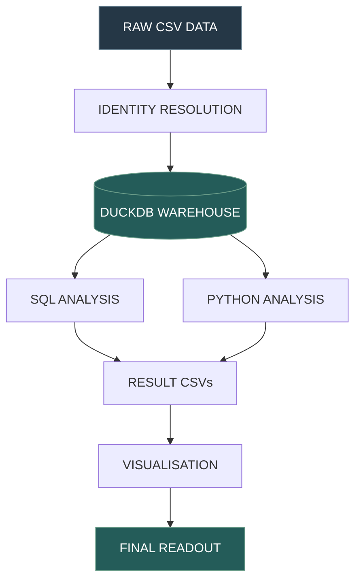

<div align="center">

# READING BETWEEN THE ROWS
### DBMS LAB · END-SEMESTER PROJECT · 2026

*An exploration of player behaviour, monetisation, acquisition, advertising and churn.*

<br>


<br>

*“The interesting part of data is often not what it tells us,*  
*but what it takes to make it tell the truth.”*

</div>

---

## 01 · The Investigation

Raw telemetry is rarely a complete story. Behind every metric lie assumptions about identity, missing observations, inconsistent records and the limits of measurement.

This project investigates player behaviour through a structured analytical workflow, examining monetisation, retention, acquisition channels, advertising engagement and churn.

**Submission:** Analytics Take-Home  
**Execution order:** 1 → 2 → 5 → 3 → 4 (as specified in the brief)

---

## 02 · The Architecture

The analysis follows a simple progression: from raw observations to a structured warehouse, from queries to statistical analysis, and finally to an interpretable readout.



### Project Structure

| Path | Description |
|:---|:---|
| `out/DBMS_LAB_readout.pptx` | Final presentation: 8 analytical slides + 4 appendix slides |
| `build.py` | Loads five CSVs, resolves player identities and builds `out/warehouse.duckdb`. Supports a `--merge` sensitivity build. |
| `sql/01a…01d_*.sql` | **Part 1:** Daily health, retention grid, spender behaviour (3 files), ad engagement (2 files). |
| `run_sql.py` | Executes Part 1 SQL and exports results to `out/<name>.csv`. |
| `analysis_2a_arpdau.py` | **Part 2a:** ARPDAU decomposition, rate vs. tier mix, bootstrap confidence intervals and sensitivity. |
| `analysis_3_channels.py` | **Part 3:** Cohort-matched channel comparison, tier-standardised analysis and contrasts with confidence intervals. |
| `analysis_3_linked_check.py` | Investigates whether `original_device_id` links represent genuine identities. |
| `analysis_linkage_test.py` | Tests linked identities against a random-pairing baseline. |
| `analysis_4_churn.py` | **Part 4:** Churn definition, player panel, logistic model and targeting trade-offs. |
| `make_charts.py` | Generates analytical visualisations from the results. |
| `build_deck.py` | Assembles the final presentation. |

---

## 03 · Reconstructing the Work

Every result should have a reproducible path back to its source.

### Execution

```bash
python -I build.py
python -I run_sql.py 01
python -I analysis_2a_arpdau.py
python -I analysis_3_channels.py
python -I analysis_4_churn.py
python -I make_charts.py
python -I build_deck.py
```

### Dependencies

Python 3 with:

`duckdb` · `pandas` · `numpy` · `scikit-learn` · `matplotlib` · `python-pptx`

Raw CSV files are read from `New folder (2)/`. If the directory changes, update `RAW` in `build.py`.

A complete end-to-end rebuild was performed, reproducing the figures reported in the presentation.

---

## 04 · The Decisions Behind the Numbers

*Analysis is not just computation. It is the discipline of questioning what gets computed.*

The following decisions shaped the final results.

<details>
<summary><b>01 — Player Identity: Device vs. Person</b></summary>

The `original_device_id` field suggests that a device may be linked to an earlier one.

Linked devices were initially merged, then tested against a random-pairing baseline. The pairs matched on platform, country, tier, channel, same-day activity and installation gap, but showed no distinguishing evidence against random pairs.

The evidence was insufficient to establish genuine player identity. Therefore, the device-level definition was retained.

**Sensitivity:** The merged build changes the headline ARPDAU decline by only 0.3 percentage points (−16.0% vs. −16.3%).

</details>

<details>
<summary><b>02 — Revenue Beyond Activity Records</b></summary>

The ARPDAU numerator includes all purchases made during the period, including purchases on days without a corresponding `player_day` record.

These purchases account for approximately 17% of total revenue.

An earlier analysis excluded them, overstating the decline to −19%. Including all purchases produces the corrected figure of **−16%**, consistent with the brief.

</details>

<details>
<summary><b>03 — Refunds and Gross Revenue</b></summary>

Negative `usd_amount` transactions (228 rows, of which 224 reverse earlier purchases) are excluded from gross revenue and tracked separately.

</details>

<details>
<summary><b>04 — The Problem with Uniqueness</b></summary>

`purchase_id` is reused across distinct transactions, with 122 IDs appearing more than once. Consequently, it was not used as a deduplication key.

</details>

<details>
<summary><b>05 — Missing Telemetry</b></summary>

The advertising telemetry gap from 5–7 March was flagged. These dates were excluded from advertising analysis and model features.

Trailing records beyond 30 April were also excluded.

</details>

<details>
<summary><b>06 — Choosing a Complete Cohort</b></summary>

Cohorts begin on 1 January 2026. Earlier installs have their initial activity days outside the telemetry window, making their retention figures inherently incomplete.

</details>

<details>
<summary><b>07 — Comparing Like with Like</b></summary>

Part 3 uses the January cohort (at least 89 days of observation) for every headline channel comparison.

Naive all-window comparisons are presented only to demonstrate the recency artefact.

</details>

<details>
<summary><b>08 — Defining Churn</b></summary>

A player is considered churned if they show no activity during days t+1 through t+14, provided they were active during at least one of days t−6 through t.

**Temporal evaluation:**
- Training: 15 January – 14 February
- Testing: 1 March – 16 April

The 14-day horizon is supported by a return-hazard analysis. Since the return hazard shows no clean plateau, robustness checks using 7-day and 28-day horizons are also reported.

</details>

---

## 05 · When the Data Disagrees

### Part 1d — Advertising Cap Analysis

Cap hits are rare across every definition examined.

<div align="center">

| Metric | Observed |
|:---|---:|
| Cap-5 player-days | < 1.1% |
| Cap-8 player-days | < 0.1% |
| Consecutive events with disagreeing cap fields | ~21% |
| Ad player-days where counter exceeds logged rows | ~22% |

</div>

The underlying cap telemetry is unreliable:

- The cap field changes within a player-day.
- The counter exceeds the number of logged rows on approximately 22% of advertising player-days.

> **Product implication:** Fix logging and instrumentation inconsistencies before making decisions about advertising frequency caps.

A decision built on unreliable measurement is unlikely to produce a reliable outcome.

---

## 06 · Beyond the Scope

*Not every question has an answer in the available data. Knowing where the evidence ends is part of the analysis.*

| Area | Limitation |
|:---|:---|
| **4b — Value of a New Install** | Skipped as permitted by the brief. Day-90 revenue is right-censored for recent installs, making the prediction problem incomplete. |
| **Offer Uplift & CPI** | Neither is available in the dataset. The break-even table in the presentation is a formula evaluated using assumed uplifts, not an empirical finding. |
| **Presentation Verification** | LibreOffice was unavailable. The deck was checked by extracting its text and table values rather than rendering every slide. Final layout should be checked in PowerPoint before submission. |

---

## 07 · The Imperfections in the Data

The full data-quality log is documented in **Appendix A3** of the presentation.

| Observation | Details |
|:---|:---|
| Installation surge | Unusual increase in installs beginning in late December 2025 |
| Purchases without sessions | 2,480 purchases recorded on non-session days |
| Pre-install purchases | 114 purchases dated one day before installation |
| Sentinel timestamps | 16,507 advertising rows with timestamp `07:59:56` |
| Missing advertising data | No advertising rows recorded on 6 March |
| Inconsistent telemetry | Cap and counter fields do not consistently agree |

---

<div align="center">

### THE LAST WORD

*Good analysis is not about making every number tell a story.*

*It is about knowing which stories the numbers can actually support.*

<br>

**DBMS LAB · END-SEMESTER 2026**

*Built with curiosity, questioned with evidence.*

</div>